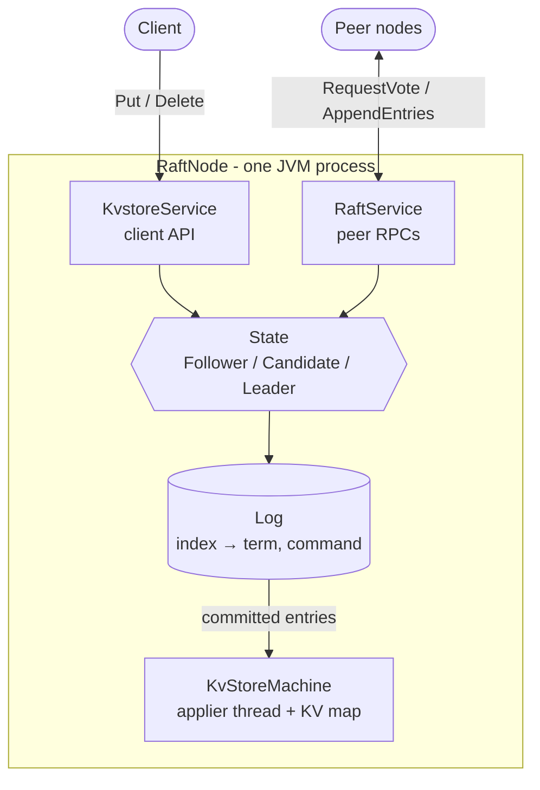

# raft-kv-store

A distributed key-value store built on the [Raft consensus algorithm](https://raft.github.io/raft.pdf), written from scratch in Java 21 with gRPC and Protocol Buffers.

The goal is a small, readable implementation of Raft. Every node runs the same deterministic KV state machine, and Raft ensures they all apply the same commands in the same order. The project is being built in phases, following Figure 2 of the Raft paper.

> **Status: work in progress.** Leader election and log replication are under active development. See [Current status](#current-status) for what works today.

---

## Architecture

Each node is a single JVM process that exposes two gRPC services on one port:



| Component | File | Responsibility |
|---|---|---|
| `RaftNode` | `entity/RaftNode.java` | Owns node-wide state (`currentTerm`, commit offset, log, peers), boots the gRPC server and the applier thread, and runs role transitions. |
| `State` (interface) | `State/State.java` | Role behaviour behind one interface: `onAppendEntry`, `onRequestVote`, `handleClientRequest`, `onEnterState`, `onExitState`. |
| `FollowerState` | `State/FollowerState.java` | Randomized election timer, vote granting with the log up-to-date check, AppendEntries consistency check, and commit-index advancement. |
| `CandidateState` | `State/CandidateState.java` | Increments the term, requests votes from all peers in parallel, and becomes leader on a majority or steps down on a higher term. |
| `LeaderState` | `State/LeaderState.java` | Sends periodic heartbeats and accepts client writes *(in progress)*. |
| `KvstoreService` | `services/KvstoreService.java` | Client-facing gRPC API. It hands commands to the current `State` and replies when the returned future completes. |
| `RaftService` | `services/RaftService.java` | Peer-facing gRPC API that delegates `RequestVote` and `AppendEntries` to the current `State`. |
| `KvStoreMachine` | `kvstore/KvStoreMachine.java` | Background thread that applies log entries to the in-memory map, in order, once they are committed (`lastApplied < commitIndex`). |

### Design choices

- **State pattern for roles.** Each role is its own class, and `RaftNode.transitionTo(from, to)` calls `onExitState()` on the old role (which cancels its timers) and `onEnterState()` on the new one. This keeps role-specific logic and timers isolated instead of spreading `if (role == LEADER)` branches across the code.
- **Commit and apply are separate.** Raft only advances the commit offset. A dedicated applier thread moves the state machine forward. This mirrors the `commitIndex` / `lastApplied` split in the Raft paper.
- **Async gRPC fan-out.** A candidate sends `RequestVote` to all peers concurrently with `CompletableFuture`. An unreachable peer simply doesn't count as a vote.
- **Client sessions in the protocol.** `Command` already carries `client_id` and `seq_no`, so exactly-once deduplication can be added without changing the wire format.

---

## gRPC API

Defined in `src/main/proto/`.

**Client API (`kvstore.proto`)**

| RPC | Request | Response |
|---|---|---|
| `Put` | `key`, `value` | `success`, `leaderId` |
| `Delete` | `key` | `success`, `leaderId` |

**Raft peer API (`raft.proto`)**

| RPC | Request | Response |
|---|---|---|
| `RequestVote` | `term`, `candidateId`, `lastLogIndex`, `lastLogTerm` | `term`, `voteGranted` |
| `AppendEntries` | `term`, `leaderId`, `prevLogIndex`, `prevLogTerm`, `entries[]`, `leaderCommit` | `term`, `success` |

**Shared types (`common.proto`)**: `LogEntry {term, index, command}` and `Command {operation (NOOP | PUT | DELETE), key, value, client_id, seq_no}`.

---

## Current status

| Phase | Scope | Status |
|---|---|---|
| 0 | gRPC + protobuf setup, Maven build | ✅ Done |
| 1 | Single-node, thread-safe KV store over gRPC | ✅ Done (commit `01ab1f7`) |
| 2 | Leader election | 🟡 In progress: follower and candidate logic done, leader heartbeat in progress |
| 3 | Log replication with commit safety | 🟡 In progress: follower side of `AppendEntries` done, leader side not started |
| 4 | Persistence, snapshots, `InstallSnapshot` | ⬜ Not started |
| 5 | Dynamic membership (optional) | ⬜ Not started |
| 6 | Fault injection and linearizability testing | ⬜ Not started |

**Implemented so far**

- Role state machine (Follower → Candidate → Leader, plus step-down on a higher term)
- Randomized election timeouts (150–300 ms), reset on a valid heartbeat or a granted vote
- Vote granting with the Raft election restriction (candidate's log must be at least as up to date)
- One vote per term
- `AppendEntries` consistency check on `prevLogIndex` / `prevLogTerm`
- Follower commit index update: `min(leaderCommit, index of last new entry)`
- Ordered applier thread for `PUT` / `DELETE`

**Not yet implemented**

- Leader heartbeats and replication (`nextIndex` / `matchIndex`, majority commit)
- Log truncation on conflicting entries
- Persistence of `currentTerm`, `votedFor`, and the log
- Leader redirect for clients, `Get` RPC, linearizable reads
- Client request deduplication
- Multi-node launcher configuration (`Main` currently starts one node on port `9999` with no peers)
- Automated tests

> **Note:** the latest commit has `LeaderState` partially written, so `HEAD` does not compile right now. To try the working single-node version, check out `01ab1f7`.

---

## Build and run

**Requirements:** JDK 21+ and Maven 3.9+.

```bash
# Generate protobuf/gRPC sources and compile
mvn clean compile

# Start a node (port 9999)
mvn exec:java -Dexec.mainClass=org.abhishek.Main
```

Generated sources are written to `target/generated-sources/protobuf/` and added to the source path automatically, so IntelliJ picks them up after a Maven reload.

**Talk to a node** with [grpcurl](https://github.com/fullstorydev/grpcurl). Server reflection is not enabled, so point grpcurl at the proto files:

```bash
grpcurl -plaintext \
  -import-path src/main/proto -proto kvstore.proto \
  -d '{"key": "name", "value": "raft"}' \
  localhost:9999 kvstore.kvstore/Put

grpcurl -plaintext \
  -import-path src/main/proto -proto kvstore.proto \
  -d '{"key": "name"}' \
  localhost:9999 kvstore.kvstore/Delete
```

---

## Project layout

```
src/main/
├── java/org/abhishek/
│   ├── Main.java                 # entry point, boots a RaftNode
│   ├── State/                    # role state machine
│   │   ├── State.java
│   │   ├── FollowerState.java
│   │   ├── CandidateState.java
│   │   └── LeaderState.java
│   ├── entity/                   # RaftNode, Peer, Command, LogEntries, Role
│   ├── kvstore/KvStoreMachine.java   # applier thread + KV map
│   └── services/                 # gRPC service implementations
│       ├── KvstoreService.java
│       └── RaftService.java
└── proto/
    ├── common.proto              # LogEntry, Command
    ├── kvstore.proto             # client API
    └── raft.proto                # peer RPCs
```

---

## Roadmap

1. **Finish leader election:** leader heartbeats to all peers, no-op entry on election, and a 3-node local cluster on ports 8001–8003.
2. **Log replication:** per-follower `nextIndex` / `matchIndex`, conflict backtracking, majority commit restricted to current-term entries (the Figure 8 rule), and completing client futures once their entry is applied.
3. **Persistence:** durable `currentTerm`, `votedFor`, and log, flushed to disk before replying to RPCs.
4. **Snapshots:** log compaction and `InstallSnapshot`.
5. **Client semantics:** leader redirect, `Get` through ReadIndex, and deduplication using `client_id` + `seq_no`.
6. **Testing:** unit tests for each role, a fault-injecting network layer (drops, delays, partitions), crash/restart tests, and linearizability checking of recorded client histories.

---

## References

- Diego Ongaro and John Ousterhout, [*In Search of an Understandable Consensus Algorithm*](https://raft.github.io/raft.pdf) (the Raft paper, especially Figure 2)
- [The Secret Lives of Data: Raft](https://thesecretlivesofdata.com/raft/)
- [MIT 6.824 / 6.5840 Distributed Systems](https://pdos.csail.mit.edu/6.824/)

## Tech stack

Java 21 · gRPC 1.72 · Protocol Buffers 3.25 · Maven · SLF4J / Logback · JUnit 5 + AssertJ
